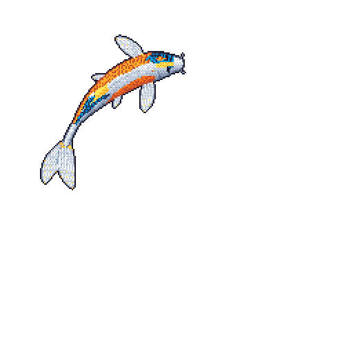

  <strong>AI Development Lead | M.Sc. (Tech.) Candidate</strong> 
  Building practical AI solutions while completing my Master's in Computer Engineering at the University of Turku.

  
  &nbsp;&nbsp; | &nbsp;&nbsp;
  

## About Me

I'm an AI Development Lead focused on designing and integrating practical AI solutions into real-world engineering environments. My background spans machine learning, data engineering, infrastructure, and software development. I'm currently completing my Master's in Computer Engineering, specializing in Data Analytics, at the University of Turku.

## Tech Stack

**AI & Data Science**

  
  

**Software Engineering**

  

**Infrastructure & Tools**

  
  
  

## What I Build

| Area | Focus |
| --- | --- |
|  **AI & Machine Learning** | Applied AI systems, machine learning pipelines, intelligent automation, RAG, and LLM integrations. |
|  **Software & Systems Engineering** | Backend services, systems programming, full-stack applications, databases, containerized infrastructure, and DevOps. |
|  **Geospatial Data & Simulation** | GIS workflows, OpenStreetMap processing, spatial databases, and simulation software. |
|  **Research & Education** | Academic research and university teaching in computer science, algorithms, and databases. |
